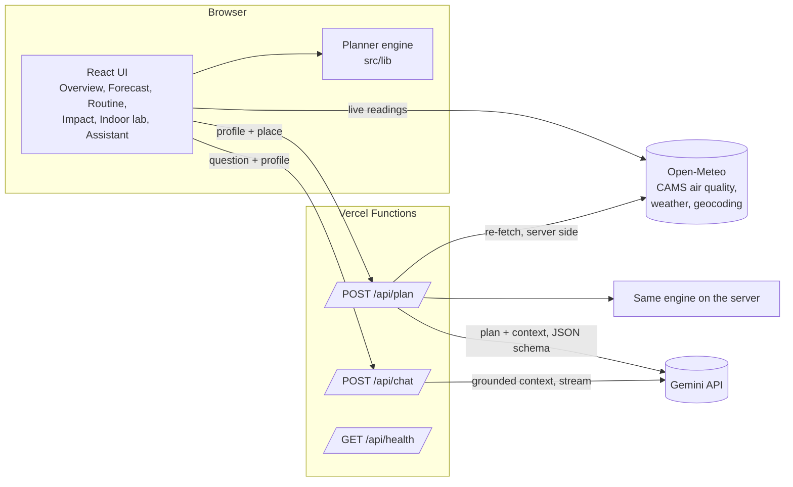

# Exhale

**Air observability for families.** Exhale is a GenAI assistant that helps families and communities get through severe winter smog. It reads live air-quality and weather data for any city, detects the smog lid that traps pollution near the ground, re-plans the household's next 24 hours for lower exposure and lower emissions, and shows the exact impact of every choice: micrograms of particulate not inhaled, cigarette-equivalents avoided and kilograms of CO2 not emitted.

- **Live app:** https://exhale-air.vercel.app
- **Challenge:** PromptWars Virtual, Challenge 6: _Urban Air Quality Assistant_ (Hack2skill × Google for Developers)
- **Built with:** Gemini API (structured output, streaming, Google Search grounding), Firebase AI Logic (hybrid on-device Gemini Nano) with App Check, React 19, TypeScript, Vite, three.js / React Three Fiber, Motion, GSAP, Vercel Functions


---

## Evaluation map

Each judging criterion has its own evidence document. Every claim in them links to the file that implements it and the test that proves it, and [tests/docs.test.ts](tests/docs.test.ts) fails the build if a document cites a missing file or a stale limit.

| Criterion                   | In one line                                                                                                   | Evidence                                     | Verify                                                          |
| --------------------------- | ------------------------------------------------------------------------------------------------------------- | -------------------------------------------- | --------------------------------------------------------------- |
| Code Quality                | Strict type-checked lint with size and complexity limits, layer boundaries and conventions enforced by tests  | [CODE_QUALITY.md](CODE_QUALITY.md)           | `npm run lint`, `npx vitest run tests`                          |
| Security                    | Same-origin API, validated input, prompt-injection tags, bounded AI cost, strict headers, pinned supply chain | [SECURITY.md](SECURITY.md)                   | `npm run audit:deps`, `npm test`                                |
| Efficiency                  | 138.8 kB first-load JavaScript against a 170 kB budget, about 2 ms per plan, cached AI                        | [EFFICIENCY.md](EFFICIENCY.md)               | `npm run build && npm run bundle:check`                         |
| Testing                     | Unit, property-based, API, UI, accessibility, end-to-end, architecture and documentation tests, all hermetic  | [TESTING.md](TESTING.md)                     | `npm run check`, `npm run test:e2e`                             |
| Accessibility               | WCAG 2.2 AA criteria mapped to code and tests; axe in jsdom and real Chrome; computed contrast                | [ACCESSIBILITY.md](ACCESSIBILITY.md)         | `npx vitest run src/pages/a11y.test.tsx tests/contrast.test.ts` |
| Problem Statement Alignment | Every phrase of the brief traced to a feature, a file and a test, for families and their communities          | [PROBLEM_ALIGNMENT.md](PROBLEM_ALIGNMENT.md) | `npx vitest run tests/workedExample.test.ts`                    |

## Chosen vertical

**Urban Air Quality Assistant.** The problem statement asks for a GenAI-powered assistant that helps families and communities navigate severe winter smog and urban air pollution, suggesting low-emission daily routines, indoor air quality hacks and sustainable alternatives tailored to location and lifestyle, while clearly explaining the direct impact of their choices.

| Requirement                        | Where Exhale does it                                                                                                                          |
| ---------------------------------- | --------------------------------------------------------------------------------------------------------------------------------------------- |
| Help families navigate winter smog | Live AQI (India NAQI or US EPA), smog-lid detection from boundary-layer height, per-person outdoor limits by age and health condition         |
| Low-emission daily routines        | **Routine** page: a re-planned 24 hours (airing time, exercise windows, commute mode and departure time), "deployed" with Gemini explanations |
| Indoor air quality hacks           | **Indoor lab** (physics model of a room), indoor-source actions in the routine, Gemini-tailored hacks                                         |
| Sustainable alternatives           | Commute mode comparison with CO2e per trip, fuel upgrades (chulha to LPG, coal heater to electric), Gemini-tailored low-emission swaps        |
| Tailored to location and lifestyle | Any city via geocoding or browser location; a household profile (people, conditions, commute, home, cooking, heating, coils, incense)         |
| Clearly explain the direct impact  | Every action carries computed impact; **Impact** page shows a habit-vs-plan diff with live what-if toggles                                    |

## Approach and logic

Exhale separates **deciding** from **explaining**:

1. **A deterministic engine decides.** All numbers come from transparent, unit-tested science code in `src/lib`. Given live data and the household profile, the planner simulates every person's next 24 hours hour by hour (where they are, how hard they are breathing, what concentration they breathe), then tests each candidate change on its own against that baseline and keeps the ones that help.
2. **Gemini explains and personalises.** The server sends Gemini the engine's plan (with ids and numbers) and the household description, and asks for a headline, a personal "why" for each action, three indoor hacks and three sustainable swaps, in a strict JSON schema. The response is validated with zod and merged back by id. Gemini never invents a number the user sees as a measurement.
3. **The assistant answers in context.** Chat answers are grounded in the same live plan; optional Google Search grounding pulls in current local advisories with sources.

This keeps the AI useful (it writes the persuasive, personal part people act on) and the advice trustworthy (the maths is reproducible and tested).

### Decision logic (user context drives every branch)

- **Outdoor limit per person.** Sensitivity is the highest multiplier from age group and conditions (child 1.5, senior 1.4, asthma 2, COPD 2, heart 1.6, pregnancy 1.5). The PM2.5 ceiling for outdoor exercise is `55 / sensitivity`, never below the WHO 24 h guideline (15 µg/m³). A healthy adult gets 55, a child with asthma 27.5.
- **Exercise.** Keep the habit if it is already within the limit and near the cleanest hour; otherwise move it to the cleanest daylight hour if that hour is within the limit; otherwise take it indoors.
- **Airing the house.** Move window-opening from the usual time to the cleanest hour between 09:00 and 17:00, when the afternoon sun lifts the mixing layer.
- **Smog lid.** Hours with boundary-layer height under 300 m and wind under 12 km/h are lid hours: keep windows shut.
- **Commute.** Rank every sensible mode for the distance by a blend of inhaled dose, CO2e and time (no option more than 60% plus 15 min slower). Suggest an N95 on open modes. If hours are flexible, shift departure when street PM2.5 drops by 20% or more within two hours.
- **Indoor sources.** Mosquito coils, incense, indoor smoking and unventilated frying are modelled as emission sources and removed or mitigated.
- **Upgrades.** Changes that cost money (box-fan filter, fuel switches) are reported separately and kept out of the free-action totals.

## How it works



1. **Data.** The browser fetches hourly PM2.5, PM10, NO2, O3, SO2 and CO (CAMS model via Open-Meteo) plus temperature, wind and planetary boundary-layer height, for the past 24 h and next 72 h. Coordinates are rounded to about 1 km before any request.
2. **AQI.** `src/lib/air/aqi.ts` computes India NAQI and US EPA AQI (2024 PM2.5 breakpoints) with the averaging periods each standard requires.
3. **Plan.** `src/lib/planner/engine.ts` simulates the day and produces actions with impacts. It runs in the browser for instant results and again on the server for the Gemini call, from data the server fetches itself rather than numbers posted by the client.
4. **Deploy.** The Routine page "deploys" a plan: a build log streams the real steps (fetch, lid detection, simulation, Gemini) and the result is stored locally as a deployment.
5. **Explain.** Gemini receives the plan and returns validated JSON; the UI shows its explanation next to the engine's own working for every action.

### Pages

| Page       | What it shows                                                                                                                                                                                                              |
| ---------- | -------------------------------------------------------------------------------------------------------------------------------------------------------------------------------------------------------------------------- |
| Overview   | AQI, a live **3D air column** (particles ∝ PM2.5 trapped under a lid at the forecast mixing height, drifting with the wind; scrub 48 h), top actions and each person's WHO exposure budget                                 |
| Forecast   | Analytics-style chart for AQI and every pollutant with lid hours and the clean window marked, a **particle donut** of how far each pollutant exceeds WHO guidelines, cleanest hours, and an animated **inversion diagram** |
| Routine    | Deploy with Gemini, build logs, every action with status, time, people, impact and a "why"                                                                                                                                 |
| Impact     | Totals, a habit-vs-plan **diff**, per-person usage rings, toggles that re-run the engine for what-if analysis                                                                                                              |
| Indoor lab | A mass-balance room simulator with live particle canvas and ranked quick wins                                                                                                                                              |
| Assistant  | Streaming chat grounded in live data and the household, optional web search with sources                                                                                                                                   |
| Settings   | The household profile: people, conditions, commute, home, fuels, sources                                                                                                                                                   |


## How the numbers work

| Quantity             | Method                                                                            | Source                                                                                      |
| -------------------- | --------------------------------------------------------------------------------- | ------------------------------------------------------------------------------------------- |
| Inhaled dose         | concentration × breathing rate × hours                                            | Breathing rates by age and activity: US EPA _Exposure Factors Handbook_ (2011), Table 6-2   |
| Cigarette equivalent | 22 µg/m³ PM2.5 for 24 h ≈ 1 cigarette                                             | Berkeley Earth (Muller & Muller, 2015)                                                      |
| Daily budget         | WHO 24 h guideline (15 µg/m³) × the person's own breathed volume                  | WHO Global Air Quality Guidelines (2021)                                                    |
| Indoor PM2.5         | Steady state `C_in = (P·a·C_out + S/V) / (a + k + CADR/V)`                        | Standard single-zone mass balance                                                           |
| Smog lid             | boundary-layer height < 300 m and wind < 12 km/h                                  | Ventilation coefficient = mixing height × wind speed (IMD uses it for dispersion forecasts) |
| Commute              | per-mode CO2e per passenger-km, in-transit exposure factors, typical urban speeds | Assumptions below                                                                           |
| Mosquito coils       | one coil ≈ PM2.5 mass of 75 to 137 cigarettes                                     | Liu et al., _Environ Health Perspect_ (2003)                                                |

## Assumptions

- Air data is model output (CAMS via Open-Meteo), not a ground monitor. Hourly values can differ from the nearest CPCB station.
- The "current" AQI uses trailing 24 h means for PM (and 8 h for O3) as the standards require; hour-by-hour views use instant values so people can act on swings.
- Indoor model: one well-mixed zone, ceiling 2.8 m, deposition 0.2 /h, penetration 0.8 with windows shut and 1.0 open; air exchange 0.3, 0.7 or 1.5 /h by draught-proofing; 6 /h with windows open.
- Indoor source strengths are order-of-magnitude values (frying 30 mg/h, incense 25 mg/h, coil 12 mg/h, cigarette 15 mg/h, chulha 80 mg/h, solid-fuel heater 60 mg/h). A kitchen hood removes 60% at source; lids plus a cracked kitchen window 30%.
- Commute factors (in-transit PM2.5 relative to ambient): walk 1.25, cycle 1.3, metro 0.7, bus 1.1, auto-rickshaw 1.45, two-wheeler 1.4, car and EV with windows up 0.65. CO2e per passenger-km: metro 0.031, bus 0.035, two-wheeler 0.055, auto 0.07, EV 0.085, petrol car 0.17. A well-fitted N95 cuts inhaled PM2.5 by about 70%.
- Default daily schedule: sleep 23:00 to 07:00, office 09:00 to 18:00 (or the commute hours), school 08:00 to 14:00, cooking at 08:00, 13:00 and 20:00, coils 22:00 to 06:00, incense at 19:00.
- Purifiers are assumed off in the baseline day, because owned purifiers are often run only occasionally; running one is a recommendation.
- Exhale gives general guidance, not medical advice.

## Google AI usage

| Where              | Gemini feature                                                  | Purpose                                                                                                                                                                                                                                                                         |
| ------------------ | --------------------------------------------------------------- | ------------------------------------------------------------------------------------------------------------------------------------------------------------------------------------------------------------------------------------------------------------------------------- |
| `api/plan.ts`      | `generateContent` with `responseJsonSchema` (structured output) | Headline, summary, per-action "why", indoor hacks, sustainable swaps, a note for the most sensitive person                                                                                                                                                                      |
| `api/chat.ts`      | `generateContentStream`                                         | Streaming assistant grounded in the live plan and household                                                                                                                                                                                                                     |
| `api/chat.ts`      | Google Search grounding (`tools: [{ googleSearch: {} }]`)       | Current local advisories (for example GRAP stages), with cited sources                                                                                                                                                                                                          |
| `server/gemini/`   | Hedged requests across a model chain, with a circuit breaker    | The deployed app puts Flash-Lite first (configurable with `GEMINI_MODEL`); if it has not answered in 7 s the next model races it and the first valid answer wins. Overloaded models cool down for 3 min; per-attempt timeouts and an overall deadline fit a serverless function |
| All calls          | `thinkingLevel: low`                                            | The engine already did the reasoning, so light thinking keeps latency and cost low                                                                                                                                                                                              |
| `server/gemini.ts` | Key rotation (`GEMINI_API_KEYS`, comma separated)               | Every key × model pair is a candidate with its own circuit breaker, so one exhausted key never takes the feature down                                                                                                                                                           |
| `server/claude.ts` | Claude Haiku (`claude-haiku-5-5`) as second provider, optional  | Used only when every Gemini key and model fails: structured JSON output (`output_config.format`) for plans and streaming for chat, with a per-minute budget. Enabled by setting `ANTHROPIC_API_KEY`                                                                             |

Without any key the app still works end to end: plans use the engine's own explanations and chat answers come from an offline responder built on the plan. The order is always Gemini, then Claude Haiku (if configured), then the rules engine.

## Hybrid on-device AI (Firebase)

On the Routine page, a switch labelled "Explain on this device (Gemini Nano)" moves the plan's personal explanations into the browser; in the Assistant, "Answer on this device (Gemini Nano)" does the same for short questions about today's plan. Both are answered by Gemini Nano inside Chrome through **Firebase AI Logic** in hybrid mode (`InferenceMode.PREFER_ON_DEVICE`). When Gemini Nano is not available, Firebase AI Logic falls back to cloud Gemini on its own, protected by **Firebase App Check** (reCAPTCHA Enterprise, with the debug provider in development). Every answer carries a badge, **On-device** or **Cloud (Firebase)**, read from the SDK's `inferenceSource`.

- **Health data stays on the device.** The household's conditions, ages and schedules go into a prompt that is built and answered in the browser.
- **Same guardrails as the server.** The prompt code moved to [src/lib/prompts](src/lib/prompts/guardrails.ts) and is shared by the server and the browser: tagged data blocks, neutralised user text and the same rules. Explanations are validated with the server's zod schema, and the numbers still come only from the engine.
- **Invisible without configuration.** Without the `VITE_FIREBASE_*` variables the switch is not rendered and no Firebase code is downloaded. With them, the SDK is a separate lazy chunk that loads only when the feature is used.

Code: [src/services/firebase/](src/services/firebase/client.ts). Set-up, console steps and what was built for #BuildHybridAI: [docs/HYBRID_AI.md](docs/HYBRID_AI.md).

## Security

Summary of [SECURITY.md](SECURITY.md), which maps every threat to the file that handles it and the test that proves it.

- **Keys stay on the server.** API keys live only in server environment variables, and a convention test proves that the only browser module reading the environment is the Firebase config, which reads only the public `VITE_FIREBASE_*` web config. Logs mask anything shaped like a key.
- **Same-origin API.** Cross-site POSTs are refused with 403 by `Origin` and `Sec-Fetch-Site` checks, and the content type must be exactly `application/json`.
- **Validated input.** Bodies are streamed with a byte cap and parsed with zod. Names and labels allow letters in any script, digits and address punctuation.
- **Prompt-injection hardening.** Every user-typed string is neutralised and wrapped in a named data tag (`place`, `name`, `item`, `household`, `history`, `user`). Replayed chat history is sent as unverified data. Model output is schema-validated and can never change a number.
- **Bounded cost.** Per-client rate limits, a tighter limit for web-grounded questions, per-instance call budgets for Gemini and Claude, and one 50 second deadline per request that always ends in an answer.
- **Strict headers**, checked by value in a test: CSP with `script-src 'self'` plus only the reCAPTCHA paths App Check needs, HSTS, `X-Frame-Options: DENY`, `nosniff`, Referrer-Policy, Permissions-Policy, COOP and CORP.
- **Supply chain.** `npm audit` gate in CI, CodeQL, dependency review, Dependabot, and every GitHub Action pinned to a commit SHA.

## Testing

Summary of [TESTING.md](TESTING.md). The whole suite is hermetic: no network, no API keys, no real AI calls.

| Layer                              | Tool                                 | Examples                                                                                                                                                                                           |
| ---------------------------------- | ------------------------------------ | -------------------------------------------------------------------------------------------------------------------------------------------------------------------------------------------------- |
| Unit and edge cases                | Vitest                               | [src/lib/air/aqi.test.ts](src/lib/air/aqi.test.ts), [src/lib/planner/edgeCases.test.ts](src/lib/planner/edgeCases.test.ts)                                                                         |
| Property-based invariants          | fast-check                           | [src/lib/planner/engine.property.test.ts](src/lib/planner/engine.property.test.ts) (the plan never makes anyone worse off), [server/rateLimit.property.test.ts](server/rateLimit.property.test.ts) |
| API handlers and AI providers      | Vitest with fake clients             | [api/handlers.test.ts](api/handlers.test.ts), [server/promptInjection.test.ts](server/promptInjection.test.ts), [server/gemini/stream.test.ts](server/gemini/stream.test.ts)                       |
| UI components and pages            | Testing Library                      | [src/pages/pages.test.tsx](src/pages/pages.test.tsx), [src/pages/assistant/conversation.test.tsx](src/pages/assistant/conversation.test.tsx)                                                       |
| Accessibility                      | axe-core in jsdom and in real Chrome | [src/pages/a11y.test.tsx](src/pages/a11y.test.tsx), [e2e/accessibility.spec.ts](e2e/accessibility.spec.ts), [tests/contrast.test.ts](tests/contrast.test.ts)                                       |
| End-to-end journeys                | Playwright, desktop and phone        | [e2e/](e2e/)                                                                                                                                                                                       |
| Architecture, conventions and docs | Vitest reading the repository        | [tests/architecture.test.ts](tests/architecture.test.ts), [tests/conventions.test.ts](tests/conventions.test.ts), [tests/docs.test.ts](tests/docs.test.ts)                                         |
| Budgets                            | Vitest and a build script            | [tests/performance.test.ts](tests/performance.test.ts), [scripts/check-bundle.mjs](scripts/check-bundle.mjs)                                                                                       |

CI ([.github/workflows/ci.yml](.github/workflows/ci.yml)) runs the dependency audit, Prettier, `tsc`, strict ESLint, Vitest with coverage thresholds, the production build, the bundle budget and the Playwright suite on every push.

### Reproduce the evaluation

Every check below runs offline, with no API key. Property tests pick a new random seed on every run; when one fails, fast-check prints the seed and path so the case replays exactly.

```sh
npm install
npx vitest run src/lib/planner/engine.property.test.ts   # safety: the plan never raises any member's dose; determinism
npx vitest run tests/workedExample.test.ts               # effect size on the fixed winter fixture (3,545 to 2,334 µg, 34%)
npx vitest run src/lib/air src/lib/science               # AQI tables, exposure and indoor model against published references
npx vitest run tests/performance.test.ts                 # planner speed budget
npm run check                                            # everything: format, types, lint, all tests with coverage
```

The reference day in `src/test/fixtures.ts` is synthetic (a Delhi-like winter inversion), not a measured day, and the doses are model estimates, not personal-monitor measurements.

## Code quality

Summary of [CODE_QUALITY.md](CODE_QUALITY.md). Every rule below is enforced by a tool, not by review.

- **TypeScript:** strict mode with `noUncheckedIndexedAccess`. Production code has no `any`, no type assertions, no non-null assertions and no `@ts-ignore`. Guaranteed values go through `defined()` ([src/lib/assert.ts](src/lib/assert.ts)), which fails loudly instead of hiding a bug.
- **ESLint:** typescript-eslint `strictTypeChecked` and `stylisticTypeChecked`, the react-hooks recommended rules and jsx-a11y, with zero warnings and no way to disable a rule inside a file. Files stay under 200 lines, functions under 60 lines, complexity 12, nesting depth 3 and 4 parameters.
- **Architecture tests:** layer boundaries (the engine never imports UI code or an AI SDK, the browser never imports server code), page folders kept private, and every module opening with a comment that states its one job.
- **Small modules:** the planner is a simulator plus one builder per kind of action behind a registry; the Gemini client is split into candidates, breaker, budget, hedged runner, JSON, stream and sources; each page composes components from its own folder.
- See [docs/ARCHITECTURE.md](docs/ARCHITECTURE.md) for the layers and data flow, [docs/DECISIONS.md](docs/DECISIONS.md) for the trade-offs, and [CONTRIBUTING.md](CONTRIBUTING.md) for the workflow.

## Accessibility

Summary of [ACCESSIBILITY.md](ACCESSIBILITY.md), which maps WCAG 2.2 AA success criteria to files and tests.

- **Checked in two places.** axe runs on every route in jsdom and again in real Chrome in both themes. Colour contrast is computed from the design tokens in a test, for every text and control pair in both themes.
- **Keyboard.** A skip link, a single tab stop with arrow keys for tabs and segmented controls, a command menu that traps and returns focus, and keyboard reading of charts.
- **Charts and 3D.** Every chart has a text summary and keyboard reading through a live region, and the Forecast chart has a data-table view. The 3D scenes are decorative, with the same facts in text beside them.
- **Meaning never by colour alone.** AQI colour is always paired with a text label.
- **Status changes are announced** through polite live regions: deploys, streaming answers, copy confirmations.
- **Motion and themes.** `prefers-reduced-motion` leaves still frames; dark and light themes; forced-colours support.
- **Language.** The Hindi community bulletin carries `lang="hi"`.

## Efficiency

Summary of [EFFICIENCY.md](EFFICIENCY.md). Budgets fail the build in CI.

- **138.8 kB gzip of JavaScript for first paint**, against a 170 kB budget. three.js, the animation library, the command menu, GSAP, the Markdown renderer and the Firebase SDK are all kept out of the first load, and the build fails if one slips in.
- **The 3D scene waits its turn:** a lightweight poster first, three.js only once it is on screen and the browser is idle, and never automatically on a data-saver connection.
- **About 2 ms per plan,** so what-if toggles recompute the whole day instantly. A performance test holds the budget.
- **Fetch once:** air data cached per ~1 km cell in the browser and on the server, failures remembered briefly, and validated AI explanations cached for 10 minutes so identical prompts are not paid for twice.
- **Cost-aware AI:** the engine does the reasoning, the cheapest capable model answers first, outputs and history are capped, and one deadline per request ends in the rules fallback rather than a timeout.
- **Loops that stop:** animations pause offscreen and when idle, and streamed chat updates once per frame without re-rendering history.

## Run locally

```bash
npm install
cp .env.example .env.local   # add GEMINI_API_KEY and VITE_FIREBASE_* (both optional)
npm run dev                  # app and /api on http://localhost:5173
npm run check                # format, typecheck, lint, tests with coverage
npm run test:e2e             # Playwright journeys in Chrome, desktop and phone
```

Deploy: import the repo in Vercel (framework: Vite) and set `GEMINI_API_KEY` as an environment variable. `vercel.json` adds the API functions, SPA routing and security headers.

## Project structure

```
api/                  Vercel Functions: plan, chat, health (thin handlers)
server/               Prompts, validation, rate limiting, logging, Claude fallback, offline answers
server/gemini/        Key x model candidates, circuit breaker, hedged runner, JSON plans, streaming chat
src/lib/science/      Exposure, indoor mass balance, commute, meteorology (cited coefficients)
src/lib/air/          Open-Meteo client, US EPA and India NAQI AQI
src/lib/planner/      Scenario, simulator, totals, summary
src/lib/planner/actions/  One builder per kind of recommendation, run from a registry
src/components/       UI kit, shell (header, tabs, command menu), charts, 3D scenes, diagrams
src/pages/            One entry per page, composed from src/pages/<page>/ components and hooks
src/state/            Household, place, theme, deployments and the private-answers choice (local, validated storage)
src/services/firebase/  Firebase app, App Check, hybrid Gemini Nano models and the typed client (lazy-loaded)
src/lib/prompts/      Prompt guardrails and CONTEXT shared by the server and the on-device path
docs/ARCHITECTURE.md  Layers, data flow, planner pipeline, AI fallback chain
docs/HYBRID_AI.md     Hybrid on-device AI with Firebase: what was built, why, and how to enable it
```

## Credits

Air quality and weather data: [Open-Meteo](https://open-meteo.com) (CAMS, ECMWF and national weather models, CC BY 4.0). Reverse geocoding: BigDataCloud client API. Fonts: Geist and Geist Mono (SIL OFL). Icons: Lucide (ISC).

**AI tools.** At runtime: the Gemini API (plan explanations and the assistant), Claude Haiku (fallback only) and, when configured, Firebase AI Logic (Gemini Nano on the device, cloud Gemini as its fallback). In development: the code, tests and docs were written with Claude Code (Anthropic) as an AI coding assistant, and every commit is marked as co-authored with it.

## License

MIT
