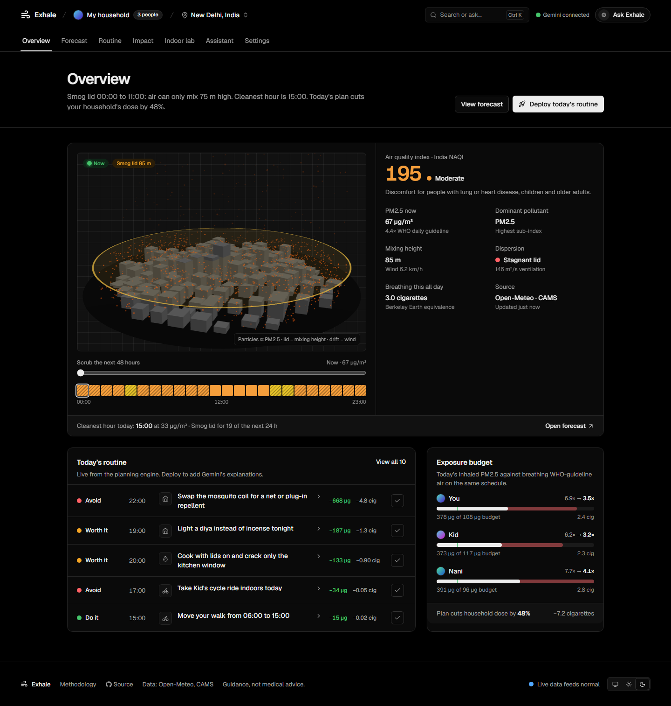
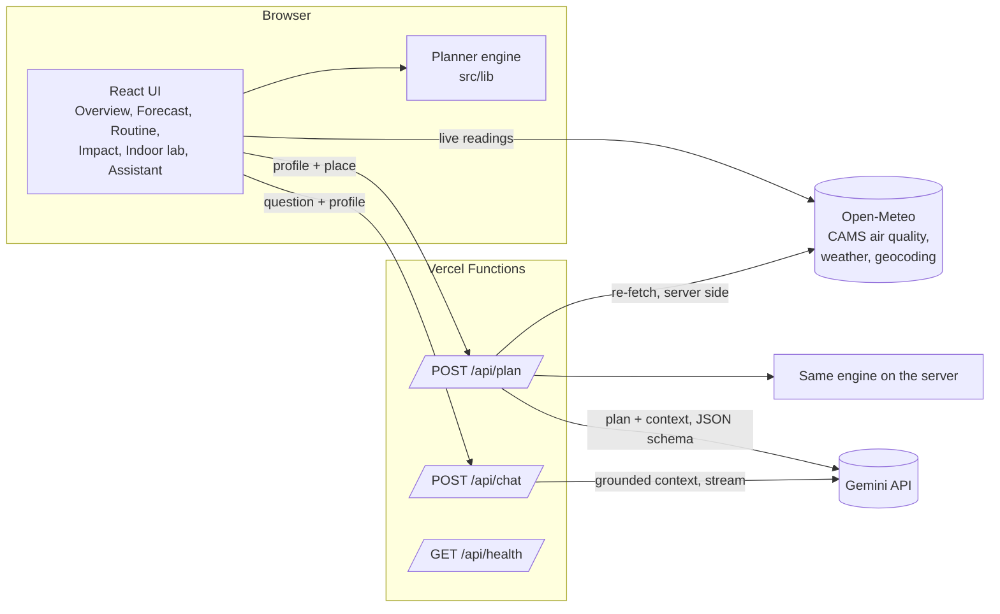
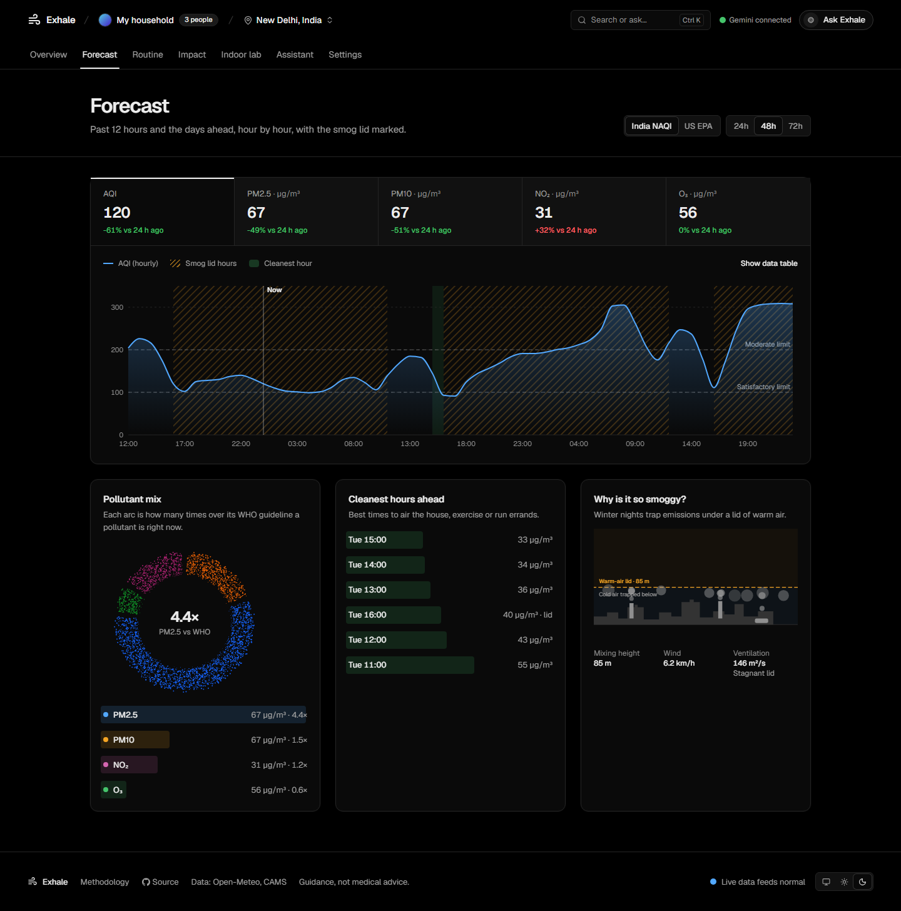

# Exhale

**Air observability for families.** Exhale is a GenAI assistant that helps families and communities get through severe winter smog. It reads live air-quality and weather data for any city, detects the smog lid that traps pollution near the ground, re-plans the household's next 24 hours for lower exposure and lower emissions, and shows the exact impact of every choice: micrograms of particulate not inhaled, cigarette-equivalents avoided and kilograms of CO2 not emitted.

- **Live app:** https://exhale-air.vercel.app
- **Challenge:** PromptWars Virtual, Challenge 6: *Urban Air Quality Assistant* (Hack2skill × Google for Developers)
- **Built with:** Gemini API (structured output, streaming, Google Search grounding), React 19, TypeScript, Vite, three.js / React Three Fiber, Motion, GSAP, Vercel Functions



---

## Chosen vertical

**Urban Air Quality Assistant.** The problem statement asks for a GenAI-powered assistant that helps families and communities navigate severe winter smog and urban air pollution, suggesting low-emission daily routines, indoor air quality hacks and sustainable alternatives tailored to location and lifestyle, while clearly explaining the direct impact of their choices.

| Requirement | Where Exhale does it |
| --- | --- |
| Help families navigate winter smog | Live AQI (India NAQI or US EPA), smog-lid detection from boundary-layer height, per-person outdoor limits by age and health condition |
| Low-emission daily routines | **Routine** page: a re-planned 24 hours (airing time, exercise windows, commute mode and departure time), "deployed" with Gemini explanations |
| Indoor air quality hacks | **Indoor lab** (physics model of a room), indoor-source actions in the routine, Gemini-tailored hacks |
| Sustainable alternatives | Commute mode comparison with CO2e per trip, fuel upgrades (chulha to LPG, coal heater to electric), Gemini-tailored low-emission swaps |
| Tailored to location and lifestyle | Any city via geocoding or browser location; a household profile (people, conditions, commute, home, cooking, heating, coils, incense) |
| Clearly explain the direct impact | Every action carries computed impact; **Impact** page shows a habit-vs-plan diff with live what-if toggles |

## Approach and logic

Exhale separates **deciding** from **explaining**:

1. **A deterministic engine decides.** All numbers come from transparent, unit-tested science code in `src/lib`. Given live data and the household profile, the planner simulates every person's next 24 hours hour by hour (where they are, how hard they are breathing, what concentration they breathe), then tests each candidate change on its own against that baseline and keeps the ones that help.
2. **Gemini explains and personalises.** The server sends Gemini the engine's plan (with ids and numbers) and the household description, and asks for a headline, a personal "why" for each action, three indoor hacks and three sustainable swaps, in a strict JSON schema. The response is validated with zod and merged back by id. Gemini never invents a number the user sees as a measurement.
3. **The assistant answers in context.** Chat answers are grounded in the same live plan; optional Google Search grounding pulls in current local advisories with sources.

This keeps the AI useful (it writes the persuasive, personal part people act on) and the advice trustworthy (the maths is reproducible and tested).

### Decision logic (user context drives every branch)

- **Outdoor limit per person.** Sensitivity is the highest multiplier from age group and conditions (child 1.5, senior 1.4, asthma 2, COPD 2, heart 1.6, pregnancy 1.5). The PM2.5 ceiling for outdoor exercise is `55 / sensitivity`, never below the WHO 24 h guideline (15 µg/m³). A healthy adult gets 55, a child with asthma 27.5.
- **Exercise.** Keep the habit if it is already within the limit and near the cleanest hour; otherwise move it to the cleanest daylight hour if that hour is within the limit; otherwise take it indoors.
- **Airing the house.** Move window-opening from the usual time to the cleanest hour between 09:00 and 17:00, when the afternoon sun lifts the mixing layer.
- **Smog lid.** Hours with boundary-layer height under 300 m and wind under 12 km/h are lid hours: keep windows shut.
- **Commute.** Rank every sensible mode for the distance by a blend of inhaled dose, CO2e and time (no option more than 60% plus 15 min slower). Suggest an N95 on open modes. If hours are flexible, shift departure when street PM2.5 drops by 20% or more within two hours.
- **Indoor sources.** Mosquito coils, incense, indoor smoking and unventilated frying are modelled as emission sources and removed or mitigated.
- **Upgrades.** Changes that cost money (box-fan filter, fuel switches) are reported separately and kept out of the free-action totals.

## How it works



1. **Data.** The browser fetches hourly PM2.5, PM10, NO2, O3, SO2 and CO (CAMS model via Open-Meteo) plus temperature, wind and planetary boundary-layer height, for the past 24 h and next 72 h. Coordinates are rounded to about 1 km before any request.
2. **AQI.** `src/lib/air/aqi.ts` computes India NAQI and US EPA AQI (2024 PM2.5 breakpoints) with the averaging periods each standard requires.
3. **Plan.** `src/lib/planner/engine.ts` simulates the day and produces actions with impacts. It runs in the browser for instant results and again on the server for the Gemini call, from data the server fetches itself rather than numbers posted by the client.
4. **Deploy.** The Routine page "deploys" a plan: a build log streams the real steps (fetch, lid detection, simulation, Gemini) and the result is stored locally as a deployment.
5. **Explain.** Gemini receives the plan and returns validated JSON; the UI shows its explanation next to the engine's own working for every action.

### Pages

| Page | What it shows |
| --- | --- |
| Overview | AQI, a live **3D air column** (particles ∝ PM2.5 trapped under a lid at the forecast mixing height, drifting with the wind; scrub 48 h), top actions and each person's WHO exposure budget |
| Forecast | Analytics-style chart for AQI and every pollutant with lid hours and the clean window marked, a **particle donut** of how far each pollutant exceeds WHO guidelines, cleanest hours, and an animated **inversion diagram** |
| Routine | Deploy with Gemini, build logs, every action with status, time, people, impact and a "why" |
| Impact | Totals, a habit-vs-plan **diff**, per-person usage rings, toggles that re-run the engine for what-if analysis |
| Indoor lab | A mass-balance room simulator with live particle canvas and ranked quick wins |
| Assistant | Streaming chat grounded in live data and the household, optional web search with sources |
| Settings | The household profile: people, conditions, commute, home, fuels, sources |



## How the numbers work

| Quantity | Method | Source |
| --- | --- | --- |
| Inhaled dose | concentration × breathing rate × hours | Breathing rates by age and activity: US EPA *Exposure Factors Handbook* (2011), Table 6-2 |
| Cigarette equivalent | 22 µg/m³ PM2.5 for 24 h ≈ 1 cigarette | Berkeley Earth (Muller & Muller, 2015) |
| Daily budget | WHO 24 h guideline (15 µg/m³) × the person's own breathed volume | WHO Global Air Quality Guidelines (2021) |
| Indoor PM2.5 | Steady state `C_in = (P·a·C_out + S/V) / (a + k + CADR/V)` | Standard single-zone mass balance |
| Smog lid | boundary-layer height < 300 m and wind < 12 km/h | Ventilation coefficient = mixing height × wind speed (IMD uses it for dispersion forecasts) |
| Commute | per-mode CO2e per passenger-km, in-transit exposure factors, typical urban speeds | Assumptions below |
| Mosquito coils | one coil ≈ PM2.5 mass of 75 to 137 cigarettes | Liu et al., *Environ Health Perspect* (2003) |

## Assumptions

- Air data is model output (CAMS via Open-Meteo), not a ground monitor. Hourly values can differ from the nearest CPCB station.
- The "current" AQI uses trailing 24 h means for PM (and 8 h for O3) as the standards require; hour-by-hour views use instant values so people can act on swings.
- Indoor model: one well-mixed zone, ceiling 2.8 m, deposition 0.2 /h, penetration 0.8 with windows shut and 1.0 open; air exchange 0.3, 0.7 or 1.5 /h by draught-proofing; 6 /h with windows open.
- Indoor source strengths are order-of-magnitude values (frying 30 mg/h, incense 25 mg/h, coil 12 mg/h, cigarette 15 mg/h, chulha 80 mg/h, solid-fuel heater 60 mg/h). A kitchen hood removes 60% at source; lids plus a cracked kitchen window 30%.
- Commute factors (in-transit PM2.5 relative to ambient): walk 1.25, cycle 1.3, metro 0.7, bus 1.1, auto-rickshaw 1.45, two-wheeler 1.4, car and EV with windows up 0.65. CO2e per passenger-km: metro 0.031, bus 0.035, two-wheeler 0.055, auto 0.07, EV 0.085, petrol car 0.17. A well-fitted N95 cuts inhaled PM2.5 by about 70%.
- Default daily schedule: sleep 23:00 to 07:00, office 09:00 to 18:00 (or the commute hours), school 08:00 to 14:00, cooking at 08:00, 13:00 and 20:00, coils 22:00 to 06:00, incense at 19:00.
- Purifiers are assumed off in the baseline day, because owned purifiers are often run only occasionally; running one is a recommendation.
- Exhale gives general guidance, not medical advice.

## Google AI usage

| Where | Gemini feature | Purpose |
| --- | --- | --- |
| `api/plan.ts` | `generateContent` with `responseJsonSchema` (structured output) | Headline, summary, per-action "why", indoor hacks, sustainable swaps, a note for the most sensitive person |
| `api/chat.ts` | `generateContentStream` | Streaming assistant grounded in the live plan and household |
| `api/chat.ts` | Google Search grounding (`tools: [{ googleSearch: {} }]`) | Current local advisories (for example GRAP stages), with cited sources |
| `server/gemini.ts` | Hedged requests across a model chain, with a circuit breaker | `gemini-3.6-flash` first; if it has not answered in 7 s a Flash-Lite model races it and the first valid answer wins. Overloaded models cool down for 3 min; per-attempt timeouts and an overall deadline fit a serverless function |
| All calls | `thinkingLevel: low` | The engine already did the reasoning, so light thinking halves latency |
| `server/gemini.ts` | Key rotation (`GEMINI_API_KEYS`, comma separated) | Every key × model pair is a candidate with its own circuit breaker, so one exhausted key never takes the feature down |
| `server/claude.ts` | Claude Haiku (`claude-haiku-5-5`) as second provider, optional | Used only when every Gemini key and model fails: structured JSON output (`output_config.format`) for plans and streaming for chat, with a per-minute budget. Enabled by setting `ANTHROPIC_API_KEY` |

Without any key the app still works end to end: plans use the engine's own explanations and chat answers come from an offline responder built on the plan. The order is always Gemini, then Claude Haiku (if configured), then the rules engine.

## Security

- The Gemini key lives only in server environment variables; the browser never sees it. `.env*` is git-ignored.
- Every request body is size-capped, content-type checked and validated with zod (coordinates, a restricted character set for names and labels, message counts and lengths).
- Prompt-injection hardening: user text is wrapped in `<user>` / `<household>` tags, the system prompt tells the model to treat it as data, and AI output is schema-validated, filtered to known action ids and rendered as text (Markdown with raw HTML disabled).
- Per-client rate limits on both AI endpoints, bounded in memory.
- Internal errors never reach the client; responses are `no-store`.
- Strict headers on every route: Content-Security-Policy (no inline scripts, allow-listed data hosts), HSTS, `X-Frame-Options: DENY`, `nosniff`, Referrer-Policy, Permissions-Policy (geolocation self only), COOP.
- Privacy: the profile, chat and plans stay in the browser's storage, are validated when read back, and can be deleted from Settings. Location is rounded to about 1 km.

## Testing

`npm test` runs 100+ tests with Vitest:

- **Science:** AQI breakpoints for both standards, averaging, dose and cigarette maths, indoor mass balance, commute ranking, lid and clean-window detection.
- **Planner:** decisions for different households (asthmatic child sent indoors, adult moved to a clean hour, habit kept when clean, WFH skips commute, upgrades separated, purifier and fuel cases), determinism, what-if selection, and that the plan never makes a day worse.
- **Server and API:** rate limiter, body limits, error hiding, prompt guardrails, Gemini hedging, retries and key rotation, the Claude Haiku fallback (structured output, refusals, budget, streaming), validation with fake clients, streaming with grounding sources, offline answers, `/api/plan`, `/api/chat` and `/api/health` handlers including invalid input, injection attempts and 429s.
- **UI:** chart keyboard reading, form primitives, routine rows, page flows (what-if toggles, purifier lowering indoor PM2.5, settings validation) and **axe-core accessibility checks** on the Overview, Settings and routine lists.

CI (`.github/workflows/ci.yml`) runs typecheck, lint, tests and build on every push.

## Accessibility

- Semantic landmarks, one `h1` per page, skip link, `aria-current` navigation, real buttons and links.
- Every chart has a text summary, keyboard reading (arrow keys, Home, End) with a live region, and a data-table view. The 3D scenes are decorative with the same information in text next to them.
- AQI colour is always paired with a text label; contrast tuned for WCAG AA in light and dark themes.
- Status changes (deployments, streaming answers) are announced through polite live regions.
- `prefers-reduced-motion` stops the 3D loops, particle canvases and diagram animation, leaving still frames.
- Forms have labels, hints and inline errors linked with `aria-describedby`.

## Efficiency

- Route-level code splitting; three.js (the heaviest dependency) loads only when a 3D view mounts, after first paint. Vendor chunks are split for long-term caching.
- Air data is cached for 10 minutes per ~1 km cell on both client (TanStack Query) and server; city search is debounced and abortable.
- WebGL scenes cap device pixel ratio, pause when offscreen or in background tabs, and use custom shaders so thousands of particles cost one draw call.
- The engine is pure TypeScript and runs in a few milliseconds, so what-if toggles recompute the whole day instantly.

## Run locally

```bash
npm install
cp .env.example .env.local   # add GEMINI_API_KEY (optional)
npm run dev                  # app and /api on http://localhost:5173
npm run check                # typecheck, lint, tests
```

Deploy: import the repo in Vercel (framework: Vite) and set `GEMINI_API_KEY` as an environment variable. `vercel.json` adds the API functions, SPA routing and security headers.

## Project structure

```
api/            Vercel Functions: plan, chat, health
server/         Gemini client, prompts, validation, rate limiting, offline answers
src/lib/        Air data client, AQI, exposure, indoor model, commute, meteorology, planner engine
src/components/ UI kit, shell (header, tabs, command menu), charts, 3D scenes, diagrams
src/pages/      Overview, Forecast, Routine, Impact, Indoor lab, Assistant, Settings
src/state/      Household, place, theme and deployments (local, validated storage)
```

## Credits

Air quality and weather data: [Open-Meteo](https://open-meteo.com) (CAMS, ECMWF and national weather models, CC BY 4.0). Reverse geocoding: BigDataCloud client API. Fonts: Geist and Geist Mono (SIL OFL). Icons: Lucide (ISC).

## License

MIT
